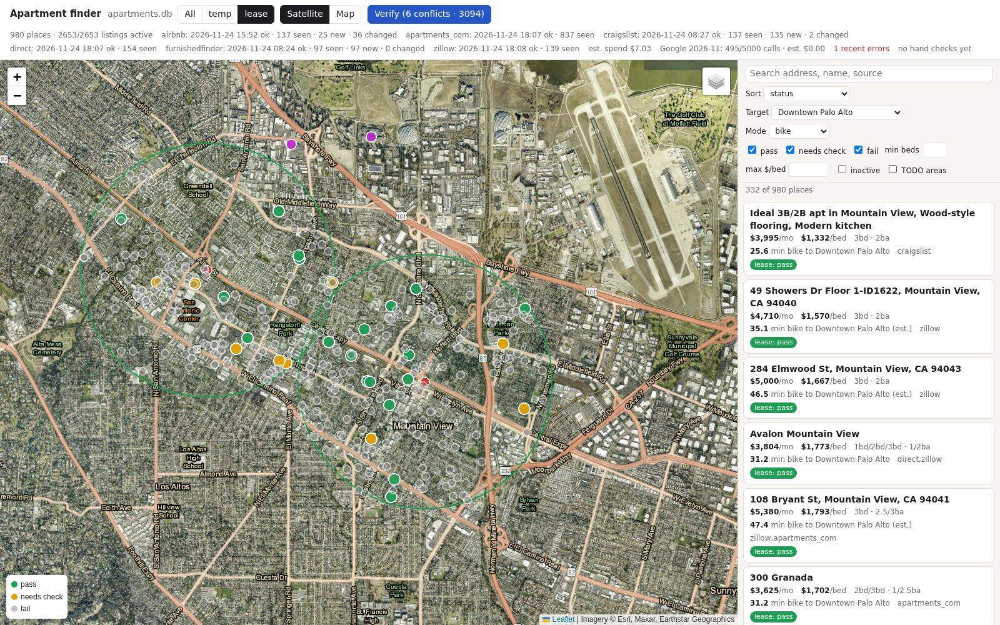
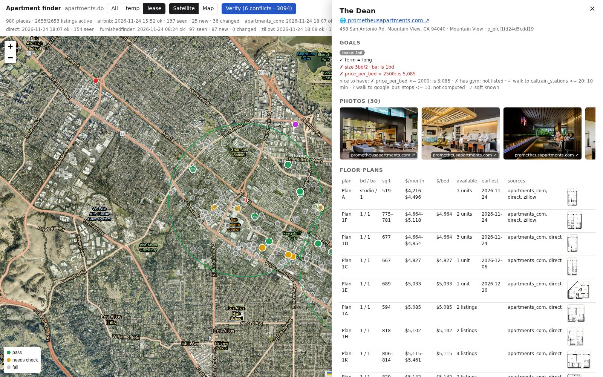
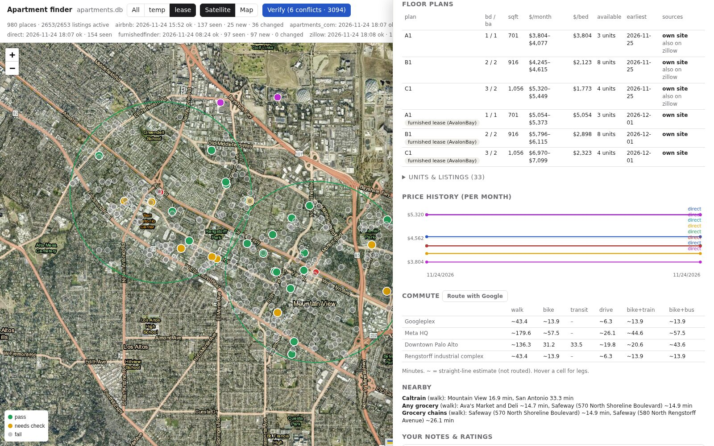
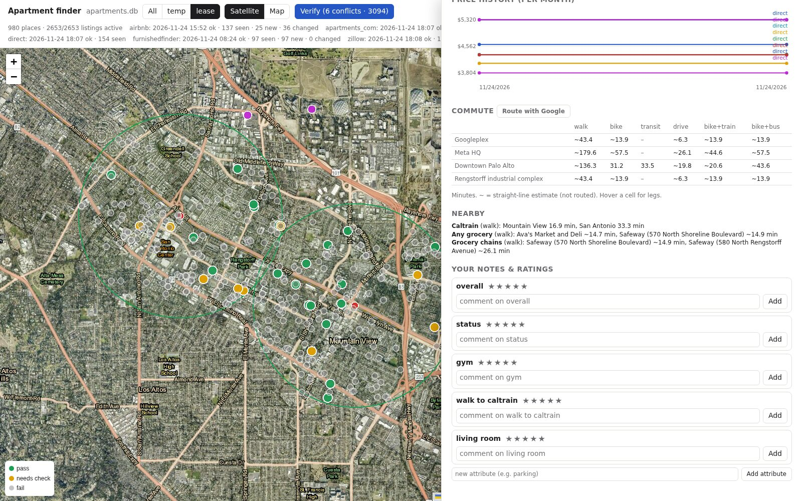

# aptfinder

A self-hosted apartment finder for the Bay Area Peninsula (Caltrain corridor, Redwood City to Sunnyvale). It gathers rentals from many sites into an append-only SQLite log and merges them into buildings and units. Claude reads the listing text, it works out commutes, and it shows each place on a map dashboard against goals you can edit.



## What it does

- **Gathers wide.** Sources: Zillow, Apartments.com, RentCafe, Zumper, PadMapper, Craigslist, Airbnb, Furnished Finder, big operators' portfolio pages, and buildings' own websites (rendered, plus a floor-plan finder). All of them run through [Apify](https://apify.com) actors. Prometheus sites come from Prometheus's own availability JSON, and apartment communities from Google Places. Goals never narrow what is collected.
- **One building, every source.** Listings are deduplicated into places and units. The rules are address, unit or floor plan, the same own website, house-number ranges, and nearby pins. Approximate Craigslist pins never move a building that another source places. A building shows its own site's floor plans next to the aggregator listings.
- **Reads the text.** Claude Haiku reads listing text, own-site pages and floor plans: address, furnished, private bath, parking and its cost, who may rent, minimum stay, fees. Prices are base rent; fee-inclusive totals are kept beside them. Sonnet settles conflicting values from stored and current pages. Every reading must quote the text verbatim.
- **Real commutes.** Modes: walk, bike, transit, drive, bike + Caltrain + bike, and bike + bus + bike, to your targets and point sets (stations, groceries, shuttle stops). Every place gets a free straight-line estimate. Google Routes and Route Matrix are sampled, and the other places read a KNN range from routed neighbours, with leave-one-out accuracy shown.
- **Goals are filters, not deletes.** Each place gets **pass**, **needs check** (naming the missing field: unknown never rejects), **fail** (with reasons) or **no listings** (the building fits but has no priced, available offer). Rules cover price, price per bed or per person, beds/baths, dates and minimum stay, commute, nearest station, amenities, parking cost, who may rent, apartment building or house, and operator.
- **Append-only history.** Every scrape is kept, so price history and "gone from the market" come for free.

## The dashboard

| | |
|---|---|
|  |  |
| Building drawer: why it passes or fails, photos from every source, floor plans | Floor plans from the building's own site, furnished leases, price history |
|  |  |
| Commute to every target by every mode (Google, KNN range or estimate), nearest stations and groceries | A second goal (furnished temporary stay) over the same data |

- **Goal editor with live preview.** Every edit is judged on the server and shown at once. An unsaved edit marks the places it **cuts** (blue) and **adds** (pink), each naming the rule responsible. Save, save as new, revert, delete. Cards price the goal's own offer (per person for a group lease) and show a net commute (mean, total, median or spread).
- **Verify.** This screen lists conflicts where sources disagree, too-cheap and no-longer-for-rent listings, likely duplicate buildings (merge in bulk), and buildings whose own site gives no prices. It also offers a seeded sample spread evenly across sources, so each source's accuracy per field is measured. A field below the trust threshold counts as unknown.
- **Pipeline panel.** It shows every stage from intake to Google routing (done, partial, stale or blocked) per source and area, with the command that runs the rest. A "do I still need to sample" table shows the commute error left per cell, and a Google dry run shows the cost before any call.


Screenshots are real data, shown with `aptf-web --redact`.

## In numbers (live instance, 2026-11-25)

- 3,253 places and 11,369 listings (10,735 active), from 11 sources plus own-site renders.
- 85,666 observations in 747 runs.
- 13,080 Google routes beside 234k free estimates.
- 45k photos and floor plans stored (1.9 GB).
- **Cost of building all of it:** about $21 of Apify credit. Google stayed inside its free tiers: 1,433 routes, 6,357 matrix elements, 2,433 geocodes and 32 Places searches. Claude ran on a Claude subscription.

## Quick start

Everything runs through Nix (`flake.nix`). Each CLI is `nix run .#<name> -- <args>` from the repo root (`db intake identity commute filter verify media eval web`). `config/`, `data/` and `.env` are read from the current directory. Without Nix: `uv sync`, then `uv run aptf-<name>`.

```sh
cp .env.example .env              # APIFY_TOKEN (needed), GOOGLE_MAPS_API_KEY (optional: real routes, Places, geocoding)
cp -r config.example config       # your config; config/ is gitignored
nix run .#db -- init              # create data/apartments.db
nix develop -c claude             # log in once: text reading uses headless `claude -p` (your subscription)
ln -s ../../scripts/check_secrets.sh .git/hooks/pre-commit    # keep your live URL and tokens out of commits
ln -s ../../scripts/check_secrets.sh .git/hooks/commit-msg
```

Edit `config/`:

- `goals.toml`: seed goals, also editable in the dashboard.
- `points/commute_targets.csv`: where you commute to. The example has public HQs and downtown Palo Alto.
- `areas.toml`: ZIPs, cities and station boxes inside the Caltrain walk zones. Regenerate with `scripts/plan_areas.py`.
- `google.toml`: monthly caps.
- `sources.toml`: actors and spend.
- `operators.toml`: market-rate and affordable-housing operators, Blueground.
- `direct_sites.toml`: buildings' own sites.
- `points/google_bus_stops.csv`: your employer's shuttle stops, if any. Header only in the example.

Then gather, read, match and route, roughly in this order:

```sh
nix run .#intake -- coverage                      # what is done and left, per source and area
nix run .#intake -- run zillow --dry-run          # which areas would run; spends nothing
nix run .#intake -- run zillow                    # also: apartments_com rentcafe zumper padmapper craigslist airbnb
                                                  #   furnishedfinder google_places portfolio direct
nix run .#intake -- extract all                   # Haiku reads listing text
nix run .#intake -- promote-sites                 # websites that listings name -> own sites
nix run .#intake -- render                        # render own sites, Haiku reads plans and prices
nix run .#intake -- prometheus                    # Prometheus availability JSON
nix run .#identity                                # match listings to buildings and units
nix run .#commute -- compute                      # free straight-line estimates for every place
nix run .#commute -- sample --pair 'commute_targets:Meta HQ|drive' --dry-run   # count Route Matrix elements first
nix run .#media -- fetch                          # keep a copy of photos and floor plans
nix run                                           # dashboard: http://127.0.0.1:8765
```

Each command takes `--help`. `--area`, `--max-items`, `--max-usd` and `--dry-run` bound any intake run. Goal results are computed when read, so editing a goal needs no rerun. The dashboard's Pipeline panel runs the Google sampling too, after a dry run you confirm.

### Serving it

- `nix run .#tunnel` runs the dashboard plus a Cloudflare tunnel (`CLOUDFLARED_TOKEN`). The dashboard has no login and can write and spend, so set `APTF_BASE_PATH=/SomeLongPhrase` in `.env` (everything else answers 404) and/or put a Cloudflare Access policy in front of it.
- On a server, run `nix run .#tunnel` as a systemd user service named `aptfinder.service`. Deploy with `scripts/deploy.sh`: it pulls, waits until no dashboard compute job is running, restarts the service and waits for it to answer.
- `nix run . -- --redact` gives a read-only view with the strings in `config/redact.toml` replaced, for screenshots (`scripts/screenshots.py`).

## Costs and caps

- **Apify:** before every actor run, a credit guard reads the account's real credit left. It caps the run at that credit minus `reserve_usd`, or refuses the run. `max_usd_per_run` (default $1) and `--max-usd` bound each run. Browser runs on the residential proxy are checked up front per page. `nix run .#intake -- credit` shows the numbers.
- **Google** (`config/google.toml`): monthly caps sit just under the free tiers. They are 5,000 computeRoutes calls, 9,000 Route Matrix elements, 900 Places searches and 4,900 geocodes. Every call is logged in `api_calls`, and `nix run .#commute -- usage` shows the month so far. With no key, everything still works on estimates.
- **Claude:** Haiku and Sonnet run through the `claude` CLI on your subscription, with no API key. Readings are cached per text, so a rerun is free.

## Reference data

Committed in `config.example/`, refreshed by hand:

- Grocery stores from OpenStreetMap: `scripts/osm_groceries.py`.
- Caltrain stations and timetable offsets: `caltrain.toml`, from the GTFS feed of 13-Nov-2026, valid to 2027-01-31.

## Development

```sh
nix develop                       # uv, Python 3.12, cloudflared, claude
env -u PYTHONPATH uv run pytest   # tests always use config.example/
scripts/check_secrets.sh --tree   # the same secret check the hooks run
```

- [design.md](design.md) is the source of truth: architecture, schema, config shapes, and a dated decision log of every change, dead end and measurement.
- [AGENTS.md](AGENTS.md) holds the working rules for coding agents: append-only logs, gather wide and filter late, Apify only, never contact a landlord, stop on bad data.

## License

MIT, see [LICENSE](LICENSE).
