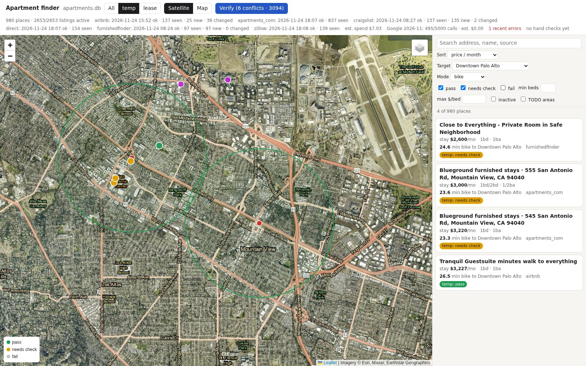
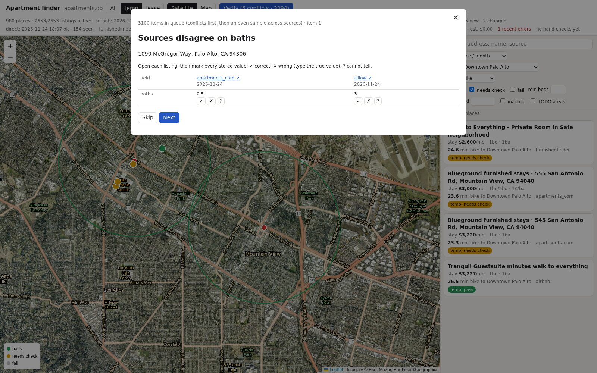

# aptfinder

Local apartment finder: gathers listings through Apify actors into an append-only SQLite log, computes commutes, filters by goals, and shows a map dashboard.


## What it does

- **Gathers wide, filters late.** Zillow, Apartments.com, Craigslist, Airbnb, Furnished Finder and buildings' own websites, all through Apify actors, area by area (Caltrain station walk zones) with a coverage ledger of what's done and what's left. Goals never narrow what gets collected.
- **One building, every source.** Listings from different sites are matched to the same place and unit, so a building shows its own website's floor plans and units next to the aggregator listings, with photos from all of them.
- **Goals are filters you can change any time.** Each listing gets pass, fail (with reasons) or needs check (naming the missing field). Unknown never rejects.
- **Real commutes.** Walk, bike, transit, drive, bike + Caltrain + bike and bike + bus + bike to your targets, with free straight-line estimates for everything and metered Google routing only where a goal needs it.
- **Measures its own accuracy.** A verify queue samples listings evenly across sources and flags fields where sources disagree, so you know which source to trust for which field.
- **Append-only history.** Every scrape is kept; price history and changes come for free.

| | |
|---|---|
|  |  |
| Building drawer: why it passes or fails, photos from every source, floor plans | Floor plans from the building's own site, furnished leases, price history |
|  |  |
| Commute to every target by every mode, nearest stations and groceries, your ratings | A second goal (furnished temporary stay) over the same data |



Screenshots are real data, shown with `aptf-web --redact` (below).

## Everything it considers

| | |
|---|---|
| **Listing** | price and what it covers (month, night, stay), price per month and per bedroom, beds (studio = 0), baths, sqft, kind (apartment, house, townhome, room, entire place), term (long lease or short stay), furnished, private bath, available from / to, amenities, floor plan, property name, operator, title, description, photos, source URL, first and last seen, active or gone |
| **Place and unit** | address, unit, city, ZIP, coordinates; which listings are the same building and the same unit; the building's own website and its floor plans |
| **Commute** | targets in `config/points/commute_targets.csv`; modes walk, bike, transit, drive (no traffic), bike + Caltrain + bike, bike + bus + bike; straight-line estimate or Google route |
| **Nearby** | nearest Caltrain stations, grocery stores (any, or chains), shuttle bus stops: any point set in `config/points/` |
| **Goal rules** | `equals` (field = value), `max` (field at most a value), `size_options` (beds with a minimum of baths), `dates_cover` (available for a date range), `commute_any` (any mode within N minutes of a target), `near` (nearest point of a set within N minutes), `amenity`, `known` (field present); each rule is either required or nice to have |
| **Trust** | per-source accuracy per field from hand checks; a field below the threshold counts as unknown (needs check) |
| **You** | ratings and comments per place on any attribute (overall, gym, living room, ...), plus hand checks of listing fields |
| **Search area** | cities, a bounding box, and Caltrain walk-zone chunks in `config/areas.toml` |
| **Spend** | Apify cost per run and a monthly reserve; Google Routes calls per run and per month |

Goal examples are in [config.example/goals.toml](config.example/goals.toml).

Everything runs through Nix (`flake.nix`); every `aptf-*` command is `nix run .#<name> -- <args>` from the repo root. Run them from the repo: `config/`, `data/` and `.env` are read from the current directory.

## 1. Setup (once)

```sh
cp .env.example .env           # APIFY_TOKEN (needed to gather), GOOGLE_MAPS_API_KEY (optional: real routes),
                               # CLOUDFLARED_TOKEN and APTF_BASE_PATH (optional: the tunnel, step 3)
cp -r config.example config    # your own config; config/ is gitignored
nix run .#db -- init           # create data/apartments.db
```

Then edit your copy in `config/`:

- `goals.toml`: what you are looking for (rules and nice-to-haves, see [Everything it considers](#everything-it-considers)).
- `points/commute_targets.csv`: where you commute to.
- `areas.toml`: the search area, split into chunks (Caltrain station walk zones). `active = [...]` lists the chunks you are working on now; places outside them show as TODO and get no paid routing. Regenerate for another region with `scripts/plan_areas.py`.
- `direct_sites.toml`: buildings' own websites to read (optional).
- `redact.toml`: strings to hide in screenshots (optional).

## 2. Gather and explore

Every scrape goes through Apify, with spend caps (`config/sources.toml`: $1 per run and a reserve). Limit what a run covers with `--chunk` (one chunk of `areas.toml`), `--area` (one ZIP, city or box id), `--max-items` and `--max-usd`, and look first with `--dry-run`:

```sh
nix run .#intake -- coverage                                     # what is done and left, per chunk, area and source
nix run .#intake -- run zillow --chunk mountain_view --dry-run   # which areas would run; spends nothing
nix run .#intake -- run zillow --chunk mountain_view             # sources: zillow apartments_com craigslist airbnb furnishedfinder direct
nix run .#intake -- run craigslist --area 94041 --max-usd 0.25   # one ZIP, capped
nix run .#identity                                               # match listings to buildings and units
nix run .#commute -- compute                                     # free straight-line estimates for every place
nix run .#commute -- --provider google compute --candidates --dry-run   # count paid Google calls first
nix run .#commute -- --provider google compute --candidates      # real routes, only where a goal can still pass
nix run .#filter -- --goal lease --status pass                   # goal results in the terminal
nix run .#eval -- recall                                         # found vs. a hand-built benchmark
```

Run `identity` and `commute compute` after each intake run. Goal results are computed on read, so editing `goals.toml` needs no rerun.

Buildings' own websites (the source of truth when found) and facts that sit only in listing text. These call headless Claude Code (`claude -p`), which the flake ships as a dependency (`claude-code`, the one unfree package it allows); log in once with `nix develop -c claude`:

```sh
nix run .#intake -- extract craigslist                           # Haiku reads listing text: address, name, website, furnished, ...
nix run .#intake -- extract furnishedfinder
nix run .#intake -- promote-sites --chunk mountain_view          # websites listings name -> fetched via Apify, address-checked, scraped
nix run .#intake -- discover-sites --chunk mountain_view --limit 40   # web search for buildings still without a site
nix run .#intake -- run direct --chunk mountain_view             # re-scrape every known building website
```

The dashboard's **Pipeline** button shows, live, every stage from intake to Google routing: done, partial, todo, stale (over a week old) or blocked, per chunk, area, source and building website, with the command that runs the rest.

A diagram of the whole pipeline, with what has run and what is planned: [pipeline flow chart](https://claude.ai/artifact/JAGKeZFdoEGYFBRyzzaG7B) (a claude.ai page, shared by link).

## 3. Run the dashboard

```sh
nix run                        # http://127.0.0.1:8765, local only
nix run .#tunnel               # the same, plus a Cloudflare tunnel (CLOUDFLARED_TOKEN in .env)
nix run . -- --redact          # read-only, strings from config/redact.toml replaced (screenshots, demos)
```

- **Tunnel:** in the Cloudflare dashboard, give the tunnel a public hostname with service `http://localhost:8765`. Use a one-level subdomain (`app.example.com`): Cloudflare's free certificate does not cover `a.b.example.com`. `CLOUDFLARED_TOKEN` is the token alone, not the whole `cloudflared ... --token` command.
- **Protect it:** the dashboard has no login and can write (ratings, checks) and spend Google calls. Set `APTF_BASE_PATH=/SomeLongPhrase` in `.env` so it only answers under that secret path (everything else is 404), and/or put the hostname behind a Cloudflare Access policy.
- `scripts/screenshots.py` takes the README images from the redacted view.

Goals, commute targets, search areas and community sites live in `config/`; without it the committed example in `config.example/` is used. See [design.md](design.md) for the architecture.

## Development

```sh
nix develop                    # uv, Python 3.12, cloudflared
uv run pytest                  # tests always use config.example/
```

## Reference data (refresh by hand)

These files are generated once and committed in `config.example/`; nothing updates them automatically. Scripts write to your `config/`; copy a refreshed file into `config.example/` to commit it.

- **Grocery stores** (`config/points/grocery_any.csv`, `grocery_chains.csv`), from OpenStreetMap through the Overpass API (free, fetched directly: reference data, not a listing site). Re-run when the search area in `config/area.toml` changes, or every few months:
  ```sh
  nix develop -c uv run python scripts/osm_groceries.py   # writes to config/points/
  ```
- **Caltrain timetable** (`config/caltrain.toml`: ride-time offsets and headways per service pattern), worked out by hand from the [Caltrain GTFS feed](https://data.trilliumtransit.com/gtfs/caltrain-ca-us/caltrain-ca-us.zip) of 13-Nov-2026. **The feed is valid to 2027-01-31**; after a timetable change, update the offsets and headways (and the `source` line) by hand. There is no script.
- **Caltrain stations** (`config/points/caltrain_stations.csv`) and **commute targets** (`config/points/commute_targets.csv`): hand-edited.
- **Google bus stops** (`config/points/google_bus_stops.csv`): empty until a stop list is added by hand.

## License

MIT, see [LICENSE](LICENSE).
